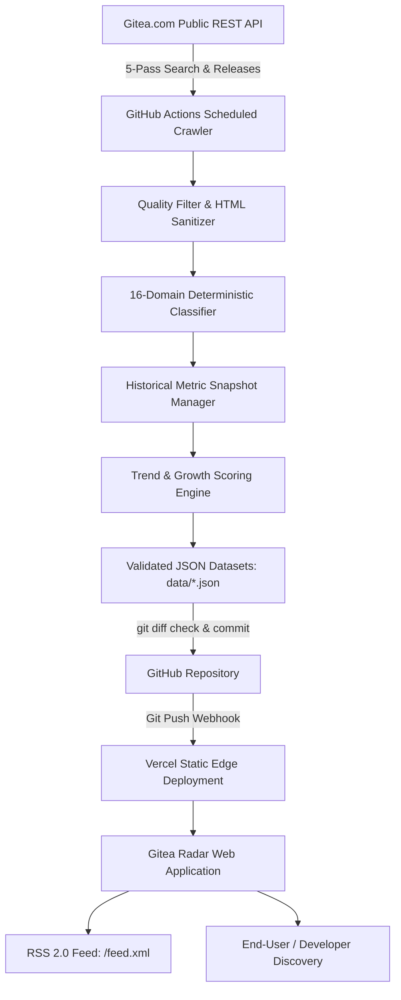

> [!NOTE]
> **Live Ecosystem Data:** Gitea Radar connects directly to the official [Gitea.com](https://gitea.com) REST API to index public repositories, compute real historical growth deltas ($\Delta \text{stars}_{24h}$), and deliver zero-overhead discovery feeds on Next.js 15 edge runtime.

<div align="center">

# 📡 Gitea Radar

### The Real-Time Open-Source Discovery Platform for the Gitea Ecosystem

**Discover what developers are building. Spot emerging tools, rising developers, and breakout software before anyone else.**

[](https://nextjs.org/)
[](https://www.typescriptlang.org/)
[](https://tailwindcss.com/)
[](.github/workflows/crawler.yml)
[](tests/)
[](LICENSE)

<br/>

**Author & Lead Architect: [JOJIN JOHN](https://github.com/jojin1709)**

---

<p><strong>Quick Launch Local Development</strong></p>

```bash
git clone https://github.com/jojin1709/gitea-radar.git && cd gitea-radar && npm install && npm run dev
```

<sub>Open <a href="http://localhost:3000">http://localhost:3000</a> to explore the radar catalog with 360+ indexed repositories.</sub>

---

</div>

> [!TIP]
> **Keyboard Shortcut:** Press <kbd>/</kbd> anywhere on the web application to immediately focus the global search engine and filter across 16 software categories, programming languages, and topics.

---

## Table of Contents

- [Overview](#overview)
  - [Why Gitea Radar Exists](#why-gitea-radar-exists)
  - [Designed for Developers](#designed-for-developers)
- [Key Capabilities](#key-capabilities)
- [Trending Algorithm](#trending-algorithm)
- [Architecture & Data Pipeline](#architecture--data-pipeline)
- [Project Structure](#project-structure)
- [Crawler & Data Engine](#crawler--data-engine)
  - [Discovery Passes](#discovery-passes)
  - [Dataset Schema Integrity](#dataset-schema-integrity)
- [Taxonomy & Classification](#taxonomy--classification)
- [RSS & Syndication](#rss--syndication)
- [Developer & Author](#developer--author)
- [License](#license)

---

## Overview

**Gitea Radar** indexes and organizes public repositories from [Gitea.com](https://gitea.com) into rich discovery feeds. Combining the aesthetic feel of *Linear*, *Vercel*, and *Hacker News*, Gitea Radar delivers instantaneous static edge performance backed by an automated GitHub Actions crawler pipeline.

<a id="why-gitea-radar-exists"></a>
<details>
<summary><strong>Why Gitea Radar Exists</strong></summary>

While GitHub has extensive discovery surfaces, the vibrant global Gitea and Forgejo ecosystem hosts hundreds of thousands of independent open-source projects, self-hosted tools, security payloads, and experimental software that often fly under the radar. 

Without centralized trending algorithms or categorization directories, discovering standout tools on Gitea used to require manual searching. **Gitea Radar closes that gap**, providing real-time ranking, 24-hour momentum graphs, domain categorization, and instant faceted search.

</details>

<a id="designed-for-developers"></a>
<details>
<summary><strong>Designed for Developers</strong></summary>

- **Zero-runtime database costs**: Pre-computed JSON feeds commit directly to Git, triggering static rebuilds without requiring a perpetually running database server.
- **Privacy & Security First**: Fully sanitized repository descriptions, protection against XSS payload titles, and clean HTTPS/SSH clone commands.
- **Historical Snapshots**: Daily and hourly metric logs retained in `data/snapshots/` to render authentic Recharts star/fork velocity graphs.

</details>

---

## Key Capabilities

- **100% Real Live Data**: Built on the official Gitea REST API (`/api/v1/repos/search` and `/releases`). Zero placeholders or fabricated numbers.
- **Multi-Pass Crawler Pipeline**: Implements exponential backoff, 429 rate limit protection, jitter, and deduplication across 5 distinct discovery vectors.
- **Multi-Factor Ranking Formula**: Ranks projects by 24h momentum, commit recency, release cadence, and freshness rather than pure static star counts.
- **Historical Growth Snapshots**: Retains timestamped hourly/daily metric snapshots (`data/snapshots/`) to compute real historical growth ($\Delta \text{stars}_{24h}$) and interactive Recharts velocity graphs.
- **Faceted Instant Search**: Instant client-side search with debounced query syncing, language, category, minimum stars, topic filtering, and live API fallback.
- **Global <kbd>/</kbd> Search Hotkey**: Press <kbd>/</kbd> from any page to focus the search interface.
- **Deterministic Domain Classification**: Classifies software into 16 distinct categories (AI, Cybersecurity, Developer Tools, DevOps, Infrastructure, Databases, Web, CLI, etc.) using package and keyword analysis.
- **RSS 2.0 Syndication Feed**: Live `/feed.xml` route for developer RSS readers, news aggregators, and automated bots.
- **Instant Edge Delivery**: 898+ static pages generated via Next.js 15 App Router SSG for sub-50ms TTFB across global CDNs.

---

## Trending Algorithm

Rather than naive $\text{stars} = \text{trending}$, Gitea Radar scores repositories via a multi-factor momentum formula:

$$\text{trendScore} = \left( (\Delta \text{stars}_{24h} \times 5) + (\Delta \text{forks}_{24h} \times 3) + \left(\frac{\text{activityScore}}{10} \times 2\right) + \left(\frac{\text{freshnessScore}}{10} \times 1\right) + \log_{10}(\text{stars} + 1) \times 1.5 \right) \times \text{archivedMultiplier}$$

| Factor | Weight | Purpose |
| :--- | :--- | :--- |
| **$\Delta \text{stars}_{24h}$** | $5.0\times$ | Rewards projects gaining active traction in the last 24 hours. |
| **$\Delta \text{forks}_{24h}$** | $3.0\times$ | Tracks genuine developer adoption and contribution forks. |
| **$\text{activityScore}$ (0–100)** | $2.0\times$ | Evaluates update recency (up to 40 pts), release freshness (up to 30 pts), and open issues (up to 30 pts). |
| **$\text{freshnessScore}$ (0–100)** | $1.0\times$ | Grants emerging breakout software a discovery boost that gently decays over 180 days. |
| **$\text{basePopularity}$** | $1.5\times$ | Log-damped star count so massive historic repos don't overpower new innovations. |
| **$\text{archivedMultiplier}$** | $0.3\times$ | Dampens archived or deprecated projects to preserve spotlight for active developments. |

---

## Architecture & Data Pipeline



---

## Project Structure

```
gitea-radar/
├── app/
│   ├── page.tsx                     # Radar Homepage (Hero, Trending, Newest, Categories)
│   ├── trending/page.tsx            # Trending feed with Today/Week/Month tabs & rank badges
│   ├── newest/page.tsx              # Chronological stream of newly discovered projects
│   ├── rising/page.tsx              # High-velocity and adoption growth feed
│   ├── popular/page.tsx             # Most starred, forked, and watched repositories
│   ├── categories/                  # 16-Domain category directory & feeds
│   ├── languages/                   # Language statistics directory & feeds
│   ├── topics/                      # Tag cloud & keyword feeds
│   ├── repository/[owner]/[name]/   # Detail page, Recharts velocity chart, clone widget
│   ├── search/page.tsx              # Debounced faceted search with URL param syncing
│   ├── feed.xml/route.ts            # RSS 2.0 feed generator for trending repositories
│   ├── api/search/route.ts          # Live Gitea REST API proxy with token auth support
│   ├── layout.tsx                   # Dark-first developer layout & metadata
│   ├── globals.css                  # Custom theme tokens & subtle radar grid
│   ├── sitemap.ts                   # Dynamic Next.js sitemap generator
│   └── robots.ts                    # SEO robots.txt
│
├── components/
│   ├── layout/                      # Header (with / hotkey), Footer (with RSS link)
│   ├── repository/                  # RepositoryCard, RepositoryList, GrowthBadge, TrendBadge
│   └── charts/                      # StarHistoryChart (Recharts AreaChart)
│
├── crawler/
│   ├── api/gitea-client.ts          # Resilient Gitea API client (backoff, rate limit handling)
│   ├── discovery/                   # Multi-pass discovery (stars, updated, created, forks, topics)
│   ├── normalization/               # Entity normalization and HTML sanitation
│   ├── filtering/                   # Quality filter (anti-spam, anti-empty, anti-XSS)
│   ├── scoring/                     # Trend, growth, and activity scorers
│   ├── snapshots/                   # Historical snapshot recorder & retention manager
│   ├── categories/                  # Deterministic multi-factor classifier
│   └── index.ts                     # Orchestrator
│
├── data/                            # Production JSON datasets & snapshot history
│   ├── repositories.json            # 360+ normalized repositories
│   ├── trending.json                # Ranked trending projects
│   ├── newest.json                  # Chronologically indexed stream
│   ├── rising.json                  # High-growth projects
│   ├── popular.json                 # Top starred & forked software
│   ├── categories.json              # Domain summaries
│   ├── languages.json               # Language breakdowns
│   ├── topics.json                  # Keyword frequencies
│   ├── stats.json                   # Platform engine totals
│   └── snapshots/                   # Hourly / daily historical JSON snapshots
│
├── tests/                           # Vitest test suites (39 tests passing)
│   ├── classification.test.ts
│   ├── filtering.test.ts
│   ├── growth.test.ts
│   ├── normalization.test.ts
│   ├── scoring.test.ts
│   ├── search.test.ts
│   ├── utils.test.ts
│   └── validation.test.ts
│
└── .github/workflows/crawler.yml    # Automated GitHub Actions pipeline
```

---

## Crawler & Data Engine

### Discovery Passes

The crawler discovers repositories through five targeted passes across Gitea's REST API:
1. **Most Starred**: Deep search across the highest starred repositories on Gitea.
2. **Recently Updated**: Finds active projects with commits within the last 24–72 hours.
3. **Recently Created**: Captures breakout new open-source software within minutes of creation.
4. **Most Forked**: Identifies community-adopted platforms and developer toolkits.
5. **Topic & Keyword Pass**: Deep scan across specialized domains (`cybersecurity`, `ai`, `cli`, `devops`, `burp`, `pentest`, `tools`, `cve`, etc.).

### Dataset Schema Integrity

All discovered entities pass strict quality filtering (anti-spam, zero-size pruning, and XSS sanitization) and deterministic domain classification before being committed to `data/*.json`. Hourly snapshot metrics are recorded in `data/snapshots/` to power the Recharts historical growth curves.

---

## Taxonomy & Classification

Gitea Radar classifies repositories into 16 discrete engineering domains:

| Category | Focus Areas |
| :--- | :--- |
| **AI** | Large language models, prompt engines, agentic frameworks, diffusion models |
| **Cybersecurity** | Pentesting tools, Burp extensions, CVE scanners, reverse engineering, OSINT |
| **Developer Tools** | Compilers, linters, debuggers, code formatters, SDKs, Neovim/Vim plugins |
| **CLI** | Terminal utilities, command-line interfaces, TUI apps, shell automation |
| **DevOps** | CI/CD runners, Gitea Actions, Docker images, Terraform, Kubernetes manifests |
| **Infrastructure** | Cloud-native systems, clustering, distributed storage, Bare-metal servers |
| **Databases** | SQL/NoSQL databases, ORMs, key-value stores, Redis caches, migrations |
| **Web** | Fullstack web apps, React/Vue/Svelte libraries, WASM components |
| **Mobile** | Flutter, React Native, Android apps, Swift/Kotlin native software |
| **Self-Hosted** | Homelab software, private cloud, home servers, personal dashboards |
| **Automation** | Web crawlers, Telegram/Discord bots, cron schedulers, workflow pipelines |
| **Networking** | WireGuard, VPNs, HTTP/SOCKS5 proxies, P2P protocols, socket servers |
| **Games** | Game engines, Godot/Unity tools, SDL2, OpenGL/Vulkan renderers |
| **Education** | Awesome lists, roadmaps, university coursework, algorithms cheatsheets |

---

## RSS & Syndication

Subscribe to trending open-source projects via standard RSS 2.0:
- **Endpoint**: [`/feed.xml`](https://github.com/jojin1709/gitea-radar/blob/main/app/feed.xml/route.ts)
- **Format**: RSS 2.0 XML with categories, publication timestamps, and direct repository links.

---

## Developer & Author

<div align="center">

### Developed by **JOJIN JOHN**
*Software Engineer • Full Stack Developer • Ethical Hacker & Security Researcher*

[](https://github.com/jojin1709)
[](mailto:jojinn1709@gmail.com)

</div>

---

## License

This project is licensed under the [MIT License](LICENSE).
Copyright &copy; 2026 **JOJIN JOHN**.
