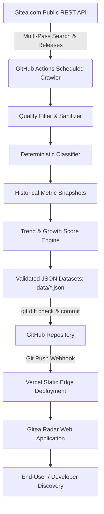

# Gitea Radar

> **Discover what developers are building.**  
> The real-time open-source discovery platform for the Gitea repository ecosystem.

[](https://nextjs.org/)
[](https://www.typescriptlang.org/)
[](https://tailwindcss.com/)
[](https://github.com/)
[](LICENSE)

---

## Overview

**Gitea Radar** indexes and organizes public repositories from [Gitea.com](https://gitea.com) into rich discovery feeds. Combining the aesthetic feel of *Linear*, *Vercel*, and *Hacker News*, Gitea Radar delivers instantaneous static edge performance backed by an automated GitHub Actions crawler pipeline.

### Key Highlights
- **100% Real Live Data**: Built on the official Gitea REST API (`/api/v1/repos/search` and `/releases`). Zero placeholders or fabricated numbers.
- **Resilient Multi-Pass Crawler**: Implements exponential backoff, 429 rate limit protection, jitter, and deduplication across multiple discovery vectors (stars, recency, activity, forks, and keywords).
- **Multi-Factor Ranking Algorithm**: Ranks projects by 24h momentum, commit frequency, issue velocity, release activity, and freshness rather than pure static star counts.
- **Historical Growth Snapshots**: Retains timestamped hourly/daily metric snapshots (`data/snapshots/`) to compute real historical growth ($\Delta \text{stars}_{24h}$) and interactive Recharts velocity graphs.
- **Faceted Search**: Instant client-side search with debounced query syncing, language, category, minimum stars, and topic filtering.
- **Deterministic Domain Classification**: Classifies software into 16 distinct categories (AI, Cybersecurity, Developer Tools, DevOps, Infrastructure, Databases, Web, CLI, etc.) using package and keyword analysis.
- **Zero Server Overhead**: The crawler commits normalized JSON files directly to Git, triggering instantaneous Vercel static rebuilds without requiring a continuously running VPS.

---

## Architecture



---

## Trending Algorithm Formula

Rather than naive $\text{stars} = \text{trending}$, Gitea Radar scores repositories via:

$$\text{trendScore} = \left( (\Delta \text{stars}_{24h} \times 5) + (\Delta \text{forks}_{24h} \times 3) + \left(\frac{\text{activityScore}}{10} \times 2\right) + \left(\frac{\text{freshnessScore}}{10} \times 1\right) + \log_{10}(\text{stars} + 1) \times 1.5 \right) \times \text{archivedMultiplier}$$

- **$\Delta \text{stars}_{24h}$ & $\Delta \text{forks}_{24h}$**: Computed strictly from real historical snapshot deltas. Returned as `null` if insufficient snapshot history exists.
- **$\text{activityScore}$ (0–100)**: Evaluates update recency (up to 40 pts), latest packaged release freshness (up to 30 pts), and open PR/issue velocity (up to 30 pts).
- **$\text{freshnessScore}$ (0–100)**: Grants emerging breakout software a discovery boost that gently decays over 180 days.
- **$\text{archivedMultiplier}$**: Sets to `0.3` for archived repos to prevent abandoned projects from crowding out active developments.

---

## Project Structure

```
gitea-radar/
├── app/
│   ├── page.tsx                     # Radar Homepage (Hero, Trending, Newest, Categories)
│   ├── trending/page.tsx            # Trending feed with Today/Week/Month tabs & rank badges
│   ├── newest/page.tsx              # Chronological stream of newly discovered projects
│   ├── rising/page.tsx              # High-velocity and adoption growth feed
│   ├── popular/page.tsx             # Most starred, forked, and watched repositories
│   ├── categories/
│   │   ├── page.tsx                 # Category directory (16 domains)
│   │   └── [category]/page.tsx      # Category-specific feed
│   ├── languages/
│   │   ├── page.tsx                 # Language directory with statistics
│   │   └── [language]/page.tsx      # Language-specific feed
│   ├── topics/
│   │   ├── page.tsx                 # Tag cloud and topic directory
│   │   └── [topic]/page.tsx         # Topic-specific feed
│   ├── repository/[owner]/[name]/
│   │   ├── page.tsx                 # Rich repository view, release notes, and charts
│   │   └── CloneSnippet.tsx         # HTTPS / SSH copy-to-clipboard widget
│   ├── search/page.tsx              # Debounced faceted search with URL param syncing
│   ├── layout.tsx                   # Dark-first developer layout & metadata
│   ├── globals.css                  # Custom theme tokens & subtle radar grid
│   ├── sitemap.ts                   # Dynamic Next.js sitemap generator
│   └── robots.ts                    # SEO robots.txt
│
├── components/
│   ├── layout/                      # Header, Footer, MobileNav
│   ├── repository/                  # RepositoryCard, RepositoryList, GrowthBadge, TrendBadge
│   └── charts/                      # StarHistoryChart (Recharts AreaChart)
│
├── crawler/
│   ├── api/gitea-client.ts          # Resilient Gitea API client (backoff, rate limit handling)
│   ├── discovery/                   # Multi-pass discovery (stars, updated, created, forks, topics)
│   ├── normalization/               # Entity normalization and HTML sanitation
│   ├── filtering/                   # Quality filter (anti-spam, anti-empty, anti-XSS)
│   ├── scoring/                     # Trend, growth, and activity scorers
│   ├── snapshots/                   # Historical snapshot recorder & retention manager
│   ├── categories/                  # Deterministic multi-factor classifier
│   └── index.ts                     # Orchestrator
│
├── data/                            # Production JSON datasets & snapshot history
│   ├── repositories.json
│   ├── trending.json
│   ├── newest.json
│   ├── rising.json
│   ├── popular.json
│   ├── categories.json
│   ├── languages.json
│   ├── topics.json
│   ├── stats.json
│   └── snapshots/                   # Hourly / daily historical JSON snapshots
│
├── tests/                           # Vitest unit test suites
├── scripts/
│   ├── run-crawler.ts               # CLI runner for crawler
│   └── validate-data.ts             # CLI validator for dataset schema integrity
└── .github/workflows/crawler.yml    # GitHub Actions scheduled workflow
```

---

## Local Development

### Prerequisites
- Node.js 18+ (tested on Node.js 22 & 24)
- npm 10+

### Setup
```bash
# 1. Clone repository
git clone https://github.com/your-username/gitea-radar.git
cd gitea-radar

# 2. Install dependencies
npm install

# 3. Configure environment (optional)
cp .env.example .env.local

# 4. Run local development server
npm run dev
```
Open [http://localhost:3000](http://localhost:3000) in your browser.

---

## Available Scripts

| Command | Purpose |
| :--- | :--- |
| `npm run dev` | Start Next.js App Router local dev server |
| `npm run build` | Compile Next.js production build |
| `npm run start` | Serve production build locally |
| `npm run test` | Run complete Vitest unit test suite |
| `npm run typecheck` | Run strict TypeScript compiler verification (`tsc --noEmit`) |
| `npm run lint` | Run ESLint checks |
| `npm run crawler` | Execute crawler against live Gitea API and write datasets |
| `npm run validate-data` | Validate all JSON datasets for schema constraints & unique IDs |

---

## Running the Crawler Locally

To trigger a live crawler run manually:

```bash
npm run crawler
```

The crawler will:
1. Query Gitea REST API across 5 discovery passes.
2. Filter low-quality, empty, and malicious repos.
3. Fetch latest release tags for top active candidates.
4. Record an hourly snapshot in `data/snapshots/`.
5. Compute real star deltas and trend scores.
6. Write normalized datasets into `data/*.json`.

Verify data correctness afterwards:
```bash
npm run validate-data
```

---

## Automated Deployment (Vercel + GitHub Actions)

### 1. Deploy to Vercel
1. Push this repository to GitHub.
2. Import the repository into [Vercel](https://vercel.com).
3. Set the Framework Preset to **Next.js**.
4. Deploy.

### 2. GitHub Actions Automation
The repository includes `.github/workflows/crawler.yml` configured to:
- Execute every 6 hours (`cron: '0 */6 * * *'`).
- Support manual execution via GitHub `workflow_dispatch`.
- Run tests and schema validation before any commit.
- Inspect `git diff --quiet data/`: only commits and triggers Vercel rebuilds when real repository changes occur.
- Append `[skip ci]` to crawler data commits to prevent recursive action triggers.

---

## Limitations & Future Roadmap

- **Upstream Rate Limits**: Gitea.com public anonymous API has rate limiting. The crawler respects this with exponential backoff and jitter; configure `GITEA_TOKEN` in secrets for larger pagination depths.
- **Activity Detail**: Gitea public search provides commit dates and release counts. Full commit graph analysis requires individual clone operations which is avoided to ensure zero overhead.
- **Future Roadmap**:
  - Optional SQLite/PostgreSQL adapter for deployments tracking > 50,000 repositories.
  - LLM-assisted repository summary extraction for projects lacking descriptions.
  - Multi-instance support (e.g. Codeberg, Forgejo, self-hosted enterprise Gitea instances).
